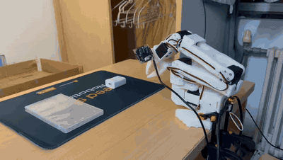

# SO-ARM101 / SO-101：LeRobot π₀.₅ 微调与真机失败复盘

基于 [LeRobot](https://github.com/huggingface/lerobot) 的 **π₀.₅（Pi05）视觉语言动作模型**，使用 SO-101 机械臂的双相机示教数据微调 `Grab Box` 任务，并在云端 RTX 4090 24 GB 上训练与推理。项目完成了数据、模型和真机运行的端到端流程，但实际任务成功率**几乎为 0**。本仓库如实展示失败样例、已核实的配置，以及下一轮实验的排查顺序。

> **项目结果**：模型能驱动机械臂向目标区域运动；所录制的这次执行未完成抓取。成功率“几乎为 0”来自项目实际测试反馈，尚无可公开核对的逐次成功／失败统计，因此不写成精确百分比。

### 一分钟真机执行记录

下方为**完整约 60 秒、静音的动图版本**，可直接在 GitHub 项目首页观看；点击动图可打开保留声音的 H.264 MP4。画面展示机械臂反复接近目标，但未完成稳定抓取。这是一段执行记录，不能代替多次试验的成功率统计。

[▶ 打开一分钟原声视频（MP4）](./media/pi05-rollout-one-minute.mp4)

## 项目资源

| 资源 | 地址 |
| --- | --- |
| 微调后模型 | <https://huggingface.co/Shanshan777/lerobot_pi05_01> |
| 示教数据集 | <https://huggingface.co/datasets/Shanshan777/lerobot_dataset_01_20261014_233057> |
| W&B 训练日志 | <https://forge.coreweave.com/wandb/1808025338-tinghua/pi05/overview>（可能需要登录或项目权限） |
| 详细操作手册 | [02-LeRobot-Pi05-微调操作手册.md](./docs/02-LeRobot-Pi05-微调操作手册.md) |
| 失败复盘与下一轮实验 | [失败复盘与改进计划.md](./docs/失败复盘与改进计划.md) |

## 其他真机执行片段

下方是此前录制的约 17 秒失败片段。**点击动图可打开带声音的完整 MP4**；它同样不是独立的成功率评估。

[▶ 打开或下载完整视频（MP4，约 17 秒）](./media/pi05-rollout-failed.mp4)

## 实验设置与实际结果

下表中的训练参数以[已发布模型的 `train_config.json`](https://huggingface.co/Shanshan777/lerobot_pi05_01/blob/main/train_config.json)为准；操作手册中的推荐命令不一定等于这次实际运行的命令。

| 项目 | 本次实验 |
| --- | --- |
| 任务与机械臂 | `Grab Box`；SO-101 follower，6 维状态／动作 |
| 数据 | LeRobotDataset v3.0；40 条示教、17,961 帧、30 fps |
| 相机 | 前视 `front`、腕部 `wrist`，均为 480 × 640 |
| 基础模型 | `lerobot/pi05_base` |
| 硬件 | 云端 RTX 4090 24 GB，训练与推理 |
| 微调方式 | `train_expert_only=true`、`freeze_vision_encoder=true`、梯度检查点、bfloat16 |
| 训练设置 | 5,000 steps；batch size 8；`n_action_steps=50` |
| 评估设置 | 配置中 `eval_split=0.0`、`eval_steps=0`，没有留出的验证集指标 |
| 真机结果 | 能接近目标区域，但抓取成功率几乎为 0；本仓库附一次失败录像 |

## 为什么失败：已知事实与待验证原因

**目前不能把失败归咎于某一个已证实的根因。** 训练完成与训练损失下降只能说明模型拟合了训练目标，不能证明在真机上能完成抓取。当前最值得验证的是：

1. **数据量、质量与覆盖范围可能不足。** 40 条、约 10 分钟示教难以覆盖物体位置、手臂初始姿态、光照与遮挡变化；还需检查夹爪接触前后的示教是否稳定、是否包含偏离后的恢复动作。没有留出的验证集，也缺少系统化真机评估。
2. **预训练与微调的视觉输入布局不同。** `pi05_base` 的配置使用三路相机槽位；发布的微调模型记录的是 `front`、`wrist` 两路，且训练配置中的 `rename_map` 为空。这是需要检查的输入分布差异，**不能仅凭键名不同就断定它是失败原因**。
3. **微调范围受限。** 本次只训练 action expert，视觉编码器与 VLM 主干保持冻结。如果现场视角与预训练数据差异较大，模型适应新场景的能力可能受限。外部案例发现更充分的微调对新机器人有帮助，但其任务和算力条件不同，不能由此断定本项目失败根因。
4. **真机执行链与时序仍需逐项对齐。** 需要核对相机顺序、224 × 224 图像预处理、状态／动作归一化、标定、夹爪动作与任务文本；若使用远程推理，还需确认客户端与训练时的图像缩放方式一致。`n_action_steps=50` 在 30 fps 下约为 1.67 秒，接近与闭合夹爪的关键阶段可能需要更频繁的观察与重规划，但必须在相同 checkpoint 上实测。

这些是**排查假设**，不是已经证明的因果结论。证据、验证方法和改进顺序见[失败复盘与改进计划](./docs/失败复盘与改进计划.md)。

## 下一轮改进

1. **先检查执行链**：并排保存两路相机原图与模型实际输入，核对相机语义、裁剪／补边、归一化统计量、关节方向和夹爪开合；回放示教动作，排除控制与标定问题。
2. **建立可比较的评估**：预先定义“夹住并抬起目标”为成功；在固定场景做 30–40 次试验，同时记录“接近、夹住、抬起”各阶段与失败类型，再在变化场景重复评估。
3. **优先提高数据质量和场景覆盖**：审核现有示教的接近、对位、闭合、抬升阶段；补采不同位置、起始姿态和光照下的高质量轨迹，并留出按 episode 划分的验证集。针对失败点加入人工纠正片段。
4. **在同一 checkpoint 上先调推理，再比较训练方案**：记录推理延迟，比较动作块执行长度、重规划频率与可用的动作融合设置；随后在相同数据和评估协议下比较训练步数及可承受的微调范围。以真机分阶段成功率选型，验证损失仅作辅助。

上述顺序参考 [Dream Machines 的 π₀.₅ 真机微调实验](https://dream-machines.eu/blog/pi05-fine-tuning)：其结果强调场景多样性、干净示教、人工纠正和推理设置。该博客使用不同机器人、任务和数据规模，数字不能直接迁移到本项目；逐项假设与对照方案见[详细复盘](./docs/失败复盘与改进计划.md)。

## 项目经历摘要

> 基于 LeRobot 与 π₀.₅ 复现 SO-101 机械臂视觉抓取微调流程：整理 40 条双相机示教数据，在 RTX 4090 24 GB 上冻结视觉语言主干、训练 action expert 5,000 步，并发布模型与数据集。完成云端推理和真机验证后发现抓取成功率几乎为 0；通过 checkpoint 配置、数据结构与失败录像定位数据覆盖、视觉输入对齐和执行链为优先排查方向，设计分阶段对照实验与标准化成功率评估。

本仓库保留复现文档和演示媒体。模型权重、原始数据与训练记录分别存放在上方链接；未包含大体积权重或数据集副本。
