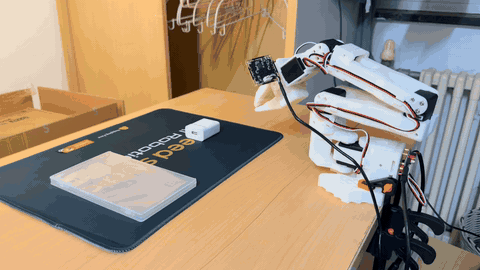

# SO-ARM101 / SO-101：LeRobot π₀.₅ 微调与真机失败复盘

基于 [LeRobot](https://github.com/huggingface/lerobot) 的 **π₀.₅（Pi05）视觉语言动作模型**，使用 SO-101 机械臂的双相机示教数据微调 `Grab Box` 任务，并在云端 RTX 4090 24 GB 上训练与推理。项目完成了数据、模型和真机运行的端到端流程，但实际任务成功率**几乎为 0**。本仓库如实展示失败样例、已核实的配置，以及下一轮实验的排查顺序。

> **项目结果**：模型能驱动机械臂向目标区域运动；所录制的这次执行未完成抓取。成功率“几乎为 0”来自项目实际测试反馈。

## 项目资源

| 资源 | 地址 |
| --- | --- |
| 微调后模型 | <https://huggingface.co/Shanshan777/lerobot_pi05_01> |
| 示教数据集 | <https://huggingface.co/datasets/Shanshan777/lerobot_dataset_01_20261014_233057> |
| W&B 训练日志 | <https://forge.coreweave.com/wandb/1808025338-tinghua/pi05/overview>（需要登录或项目权限） |
| 详细操作手册 | [02-LeRobot-Pi05-微调操作手册.md](./docs/02-LeRobot-Pi05-微调操作手册.md) |
| 失败复盘与下一轮实验 | [失败复盘与改进计划.md](./docs/失败复盘与改进计划.md) |

## 真机执行视频

**点击动图可打开带声音的完整 MP4**；动图仅用于预览，不是独立的成功率评估。

[▶ 打开或下载完整视频（MP4，约 17 秒）](./media/pi05-rollout-failed.mp4)

## 实验设置与实际结果

下表中的训练参数以[已发布模型的 `train_config.json`](https://huggingface.co/Shanshan777/lerobot_pi05_01/blob/main/train_config.json)为准；操作手册中的推荐命令不一定等于这次实际运行的命令。

| 项目 | 本次实验 |
| --- | --- |
| 任务与机械臂 | `Grab Box`；SO-101 follower，6 维状态／动作 |
| 数据 | LeRobotDataset v3.0；40 条示教、17,961 帧、30 fps |
| 相机 | 前视 `front`、腕部 `wrist`，均为 480 × 640 |
| 基础模型 | `lerobot/pi05_base` |
| 硬件 | 云端 RTX 4090 24 GB，训练与推理 |
| 微调方式 | `train_expert_only=true`、`freeze_vision_encoder=true`、梯度检查点、bfloat16 |
| 训练设置 | 5,000 steps；batch size 8；`n_action_steps=50` |
| 评估设置 | 配置中 `eval_split=0.0`、`eval_steps=0`，没有留出的验证集指标 |
| 真机结果 | 能接近目标区域，但抓取成功率几乎为 0；本仓库附一次失败录像 |

## 为什么失败：已知事实与待验证原因

**目前不能把失败归咎于某一个已证实的根因。** 训练完成与训练损失下降只能说明模型拟合了训练目标，不能证明在真机上能完成抓取。当前最值得验证的是：

1. **数据量与覆盖范围不足。** 40 条、单任务示教很难覆盖物体位置、手臂初始姿态、光照与遮挡变化；又没有留出的验证集，无法从训练曲线识别泛化问题。
2. **预训练与微调的视觉输入布局不同。** `pi05_base` 的配置使用三路相机槽位；发布的微调模型记录的是 `front`、`wrist` 两路，且训练配置中的 `rename_map` 为空。这是需要检查的输入分布差异，**不能仅凭键名不同就断定它是失败原因**。
3. **感知模块被冻结。** 本次只训练 action expert，视觉编码器与 VLM 主干保持冻结。如果现场视角与预训练数据差异较大，模型适应新场景的能力可能受限。
4. **真机执行链仍需逐项对齐。** 需要核对相机顺序、224 × 224 图像预处理、状态／动作归一化、标定、夹爪动作与任务文本；若使用远程推理，还需确认客户端与训练时的图像缩放方式一致。50 步动作块也可能让动作纠偏不够及时。

这些是**排查假设**，不是已经证明的因果结论。证据、验证方法和改进顺序见[失败复盘与改进计划](./docs/失败复盘与改进计划.md)。

## 下一轮改进

1. **先检查执行链，再重新训练**：并排保存两路相机原图与模型实际输入，核对相机键名、裁剪／补边、归一化统计量、关节方向和夹爪开合；同一初始状态下比较数据集动作回放与模型动作。
2. **建立可比较的评估**：预先定义“夹住并抬起目标”为成功；固定场景先做至少 20 次测试，记录每次起始条件、是否接近、是否夹住、是否抬起与失败视频。
3. **补充多样化示教并留验证集**：覆盖不同物体位置、初始姿态和光照；按 episode 划分训练／验证，避免同一条示教的相邻帧同时进入两边。
4. **做小规模对照实验**：在同一评估条件下比较不同训练步数、相机映射与较短动作块；选择真机成功率更高的 checkpoint，而非仅按训练损失选择。

## 项目经历摘要

> 基于 LeRobot 与 π₀.₅ 复现 SO-101 机械臂视觉抓取微调流程：整理 40 条双相机示教数据，在 RTX 4090 24 GB 上冻结VLM主干、训练 action expert 5,000 步，并发布模型与数据集。完成云端推理和真机验证后发现抓取成功率几乎为 0；通过 checkpoint 配置、数据结构与失败录像定位数据覆盖、视觉输入对齐和执行链为优先排查方向，设计分阶段对照实验与标准化成功率评估。

本仓库保留复现文档和演示媒体。模型权重、原始数据与训练记录分别存放在上方链接；未包含大体积权重或数据集副本。
